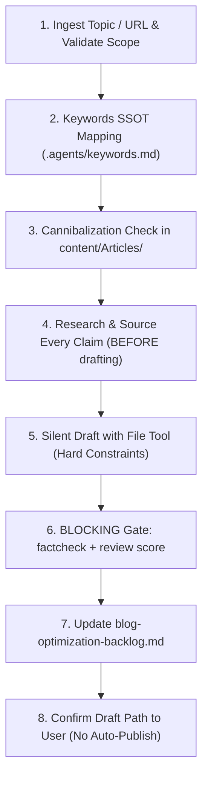

# Weekly Blog Generation & Optimization Skill

> [!important] Hard Principle: Draft for Review Only (Never Auto-Publish)
> Your task is to interactively draft a weekly blog post for **review** — not to publish it automatically. Always save with `draft: true` and `status: draft`.
>
> **Master Workflow Specification:** [`content/conductor/weekly-blog-workflow.md`](file:///c:/Users/super/Desktop/obsidian/masrisystems-app/content/conductor/weekly-blog-workflow.md)

---

## 🎯 Content Scope

This blog is a business channel for [masri.blog](https://masri.blog) / [masrisystems.com/blog](https://masrisystems.com/blog) and exists to drive SEO traffic and qualified leads for **Masri Systems**.

**In Scope:**
- Custom software development & system integration (VILT Stack: Laravel 12, Inertia v2, Vue 3, Tailwind v4)
- Website design & development (starter, growth, enterprise tiers, conversion landing pages)
- E-commerce / online shop development (Shopify Plus, headless)
- Mobile application development
- Hosting & website care / maintenance
- Consulting & strategy, industry niches
- AI workflows, MCP server development, business process automation

**Out of Scope:**
- Personal notes, unrelated hobbies, anything not connected to a Masri Systems service or software/business space. If a suggested topic doesn't fit, ask the user to reframe.

**Topic Ingestion Modes:**
1. **Freeform topic:** User describes what to write about (optionally with raw notes/audio).
2. **Reference mode:** User pastes a URL to an article. Fetch it, extract core ideas, and write an **original** Masri Systems-voiced post covering the subject from your own angle. Never reproduce more than a short quote (<15 words). Credit source if directly referenced.

---

## 📋 Step-by-Step Execution Pipeline



### 1. Ingest Topic & Process Inputs
- Confirm topic fits the Content Scope above.
- If a reference URL was given, extract core ideas into concept-only bullet points.
- Identify primary angle tailored to technical founders, CTOs, and business decision-makers.

### 2. Keywords Allocation from SSOT
- Load `[[.agents/keywords.md]]`.
- **Keyword Allocation:** **1 prime target keyword** + **6 medium-to-high competition secondary keywords with high search volume**.
- **Paragraph Focus:** Focus on **1 keyword per paragraph** for natural contextual flow.
- **Keyword Density:** Maintain **0.5–1.5% keyword density** (`Number of keywords / Total word count`).

### 3. Cannibalization Check
- Search `content/Articles/**/*.md` for existing articles covering the same topic or targeting the same `target_keyword`.
- If a duplicate/close match exists, halt and ask the user whether to (a) update/expand the existing article, or (b) draft a new post with a distinctly different angle and target keyword.

### 4. Research & Source Every Load-Bearing Claim (BEFORE Drafting)

> [!danger] Not optional. Do not begin drafting until this is done.
> A previous post shipped three unsourced statistics and a factually wrong Core Web Vitals threshold because this step did not exist. Fact-*checking* at the end cannot rescue numbers invented at the start.

- **List load-bearing claims first:** statistics, percentages, official thresholds, version numbers, pricing, market share, dated product behaviour, comparative rankings.
- **Source each before it enters the draft**, preferring:
  1. **Tier 1 — primary/official:** vendor docs, official newsrooms, standards bodies (`web.dev`, `developers.google.com`, Apple Newsroom, official repos).
  2. **Tier 2 — reputable independent research:** BrightLocal, StatCounter, Stack Overflow Developer Survey, academic papers, government statistics.
  3. **Tier 3 — established industry press** with a named author and dated methodology.
  - **Never cite** SEO content farms, undated listicles, AI-generated aggregators, or competitor marketing copy.
- **Verify against the source, not memory.** Fetch the page and confirm the figure literally appears. Official thresholds are the most common trap.
- **Unsourceable claim ⇒ cut it or soften it** to a qualitative statement with no number attached. Never invent a plausible-looking percentage.
- May use the `blog-researcher` agent or `blog-discourse` skill for discovery — they assist this step, they do not replace the sourcing bar.
- **First-hand claims** ("we cut build time 40%") must be genuinely ours and verifiable from repo, vault, or client record. Otherwise cut.

### 5. Drafting Rules & Hard Constraints (SILENT GENERATION)

Do NOT output the raw post text into the chat. Generate internally and use the file writing tool to create the draft.

- **Length Cap:** Strictly under **1,000 words total** (body copy, excluding frontmatter/FAQ).
- **SEO-Optimized Filename:** Clean, lowercase kebab-case containing the prime keyword (e.g., `ai-video-automation-workflow.md`, `laravel-inertia-performance.md`).
- **Brand & Author:** Always set `author: "Masri Systems"`. **NEVER** use "Mohamad Masri".
- **Zero Redundant H1:** The page header automatically renders the frontmatter `title:` as the page `<h1>`. Therefore, **do NOT repeat `# Title` in the markdown body**.
- **Hero Image & Nano Banana Generation Pipeline:**
  - Must be the **very first element** immediately following the closing `---` of the frontmatter.
  - **Generation:** Load `content/private/Prompts/Images/Blog Hero Image Prompt (Nano Banana 16-9).md` and generate a 16:9 widescreen concept using Nano Banana.
  - **CRITICAL GBP CONSTRAINT:** Google Business Profile (GBP) does **NOT** accept WebP uploads. Always produce high-res **JPG** (`.jpg`) alongside WebP.
  - **Optimization:** Run the `optimize image` (`image-webp-geotag`) skill:
    1. Save high-res **JPG** (`.jpg`, quality 92) for Google Business Profile (GBP), Apple Business Connect, and social media packs.
    2. Generate optimized **WebP** (`1200x675`, 16:9, quality 85) for web rendering.
    3. Rename to `masrisystems-[subfolder]-[target-keyword]-oldenburg.jpg` and `.webp`.
    4. Geotag with Oldenburg coordinates (`53.136829, 8.196328`) & embed IPTC/EXIF metadata from `brand.json` into both JPG and WebP files.
    5. Save `.jpg` to `content/Assets/GBP/`, `content/Assets/Blog/`, and `public/images/`.
    6. Save `.webp` to `content/Assets/Blog/`, `public/images/`, and root `images/`.
  - **Upload to Cloudflare R2 (required before embedding).** From `masrisystems-app/`:
    ```bash
    php artisan storage:r2-sync --dir=public/images
    ```
    Uploads `public/images/**` to the `images/` prefix on R2, skipping files already present (`--force` to overwrite a regenerated asset, `--dry-run` to preview). Bare `storage:r2-sync` also syncs `content/Assets/**` to the `assets/` prefix. Public CDN base = `AWS_URL` in `masrisystems-app/.env`.
  - **Embed the R2 URL with standard markdown syntax, referencing the `.webp`:**
    ```markdown
    
    ```
    - `.webp` in the blog body (~30% smaller — the same sub-second standard these posts preach). The `.jpg` sits on R2 at the same path with a `.jpg` extension and is what goes to **GBP / Apple Business Connect / social** — GBP rejects WebP.
    - ⚠️ **Never use `![[...]]` for a remote image.** Obsidian embed syntax resolves against vault files only; given a URL it renders as a broken wikilink, not an ``. External images are always ``.
    - Verify the URL returns `200` before saving the draft.
  - **Fallback chain (in order):**
    1. **Pixabay** (preferred) — free for commercial use, **no attribution required**. Search `site:pixabay.com [topic keywords]`.
    2. **Pexels** — free for commercial use, **no attribution required**. Search `site:pexels.com [topic keywords]`.
    3. **Unsplash** (last resort — **requires footer attribution**, hence lowest priority). Parameterize with `?auto=format&fit=crop&w=1200&h=675&q=80`.
    - Any source must still be 16:9 (`1200x675`) with keyword-rich alt text. Add a footer attribution block **only** when the source requires one (Unsplash) — never emit empty credit lines for Pixabay/Pexels.
- **Obsidian Callouts & AI SEO Structure:**
  - Starts immediately after hero image with `> [!summary] TL;DR` definition block (40–60 words).
  - Clean `##` and `###` section hierarchy with Table of Contents.
  - `> [!tip]` callouts for extractability by AI search engines (Google AI Overviews, Perplexity).
  - Structured FAQ section (3 Q&As) before footer.
- **Verified Internal Wikilinks:** Include **3–10 wikilinks** (matches `blog-seo-check`'s audit range; the old 2–3 floor let a post ship with one link and still pass) to **genuinely existing** vault notes or services (e.g., `[[Clean Architecture]]`, `[[Software Development]]`). Prefer published (`draft: false`), topically-matched targets, spread through the body. Verify each target exists before saving. Never create broken 404 links.
- **Heading Style — Never Number H2s:** Write `## Section Title`, not `## 1. Section Title`. Quartz's TOC auto-numbers headings; manual numbering renders doubled.
- **Data Charts (optional):** For posts comparing real quantities (benchmarks, pricing, market share, before/after), generate an inline SVG via the `blog-chart` skill using **sourced** figures from step 4. Requires `role="img"` + `aria-labelledby` and a transparent background. Skip entirely when there is no real dataset — an invented chart is worse than none.
- **`untell` Anti-AI Humanization Rules:**
  - **Banned AI Clichés:** *delve into, tapestry, revolutionize, in today's fast-paced world, game-changer, unleash, it's worth noting, pivotal, seamlessly, furthermore, moreover, holistic, testament*.
  - **Burstiness & Rhythm:** Alternate punchy 3–6 word sentences with compound technical explanations.
  - **Engineering Grounding:** Ground arguments in real engineering constraints (API rate limits, memory overhead, hosting cost, bundle size).
- **Mermaid.js Diagram:** Include one flowchart only if it genuinely clarifies a complex process. Never emit an empty mermaid block.
- **5 Related Hashtags:** Add 5 consistent hashtags below footer attributions (e.g. `#MasriSystems #WebDesign #SoftwareDevelopment #TechInnovation #SEO`).

### 6. Exact Frontmatter Specification

```yaml
---
title: "Engaging Title Containing the Prime Keyword"
meta_description: "Max 155 characters, CTR-optimized summary."
target_keyword: "prime keyword"
tags:
  - coding/ai
  - web-development
  - automation
author: "Masri Systems"
created: YYYY-MM-DD
updated: YYYY-MM-DD
draft: true
status: draft
subfolder: "ai"
aliases:
  - Short Alt Title
---
```

> [!warning] Critical YAML Frontmatter Rules
> 1. **Both `draft: true` and `status: draft` are required.** Quartz's RemoveDrafts filter checks `draft:` only — it never reads `status`. A post with `status: draft` but `draft: false` **goes live on the next deploy**.
> 2. **NEVER prefix YAML tags with `#`.** Write `- coding/ai`, NOT `- #coding/ai` (a hash after space creates a YAML comment and strips all tags).
> 3. **The field is `meta_description:`, not `description:`.** `Head.tsx` resolves `socialDescription` → `description` → `meta_description` → auto-extracted body text, and the same value feeds the auto-emitted `BlogPosting` JSON-LD.

### 7. File Save Location

Save draft directly to:
`content/Articles/[Category]/[Subfolder]/[keyword-slug].md`

**Approved Categories:**
- `Coding/AI` — AI agents, LLM tooling, automated workflows
- `Coding/Backend` — APIs, servers, databases, Laravel/PHP
- `Coding/Frontend` — UI/UX, Vue/React, Tailwind, design systems
- `Coding/E-commerce` — Online stores, checkout, conversion
- `Coding/SEO` — Technical and content SEO strategies
- `Coding/Tools` — Developer tooling, productivity software
- `Business` — Services, agency strategy, pricing, positioning

*(Never save under Personal, Trading, German, or kuraan).*

### 8. Quality & SEO Gate (BLOCKING)

Run the `claude-blog` sub-skills at `~/.agents/skills/blog-*`. They never override this file's hard constraints — where they conflict, **this file wins**. Two gates are **blocking**: the draft does not reach the backlog until both pass.

**🔴 Gate A — `blog-factcheck` returns ZERO unverified claims.**
Every statistic, threshold, percentage, and dated product claim must resolve at its cited source. Anything UNVERIFIED is **cut or softened before proceeding** — not caveated, not left for the human. Blocking because it already failed in production: a post shipped a Core Web Vitals threshold contradicting Google's own published figure while this check was advisory.

**🔴 Gate B — review score ≥ 85/100 AND zero P0 issues.**
A P0 (fabricated statistic, unsupported first-hand claim, broken load-bearing link) blocks **regardless of score** — a draft can score 95 and still carry one fabricated number.

> [!warning] Expected false positive: author attribution
> `blog-reviewer` scores E-E-A-T partly on attribution to a **named individual**. This site deliberately attributes to the organisation (`author: "Masri Systems"`, never "Mohamad Masri") — that policy **outranks the reviewer**.
> **Dismiss any finding asking for a personal byline, author bio, or named-expert credential. Do not "fix" it.** Because this costs unrecoverable E-E-A-T points, the floor is **85, not claude-blog's default 90**. If E-E-A-T alone drags the score under 85, document it and proceed.

**Non-blocking (fix what they flag, don't chase the number):**
- `blog-seo-check` — title, meta description, heading hierarchy, **internal-link count (3–10)**, external links, alt text.
- `blog-geo` — AI-citation readiness. Never sacrifice the 1000-word cap to raise it.
- `blog-schema` — **BlogPosting JSON-LD is emitted automatically** by `quartz/components/Head.tsx`. Do **not** hand-write Article/BlogPosting/Person/Organization blocks into posts. Use this skill only for supplementary types the emitter does not cover (`FAQPage` when a visible Q&A exists, `BreadcrumbList`). Two conflicting `BlogPosting` entities on one page is worse than one.

### 9. Synchronize Master Backlog & Confirm
1. Update `content/conductor/blog-optimization-backlog.md` (mark row status as `✅ Optimized` and update summary counts).
2. Confirm to user in chat:
   > *"The draft blog post '[Topic]' has been written to `[Path]` with `draft: true`. It is safely gated and NOT published. Please review it whenever you're ready."*
